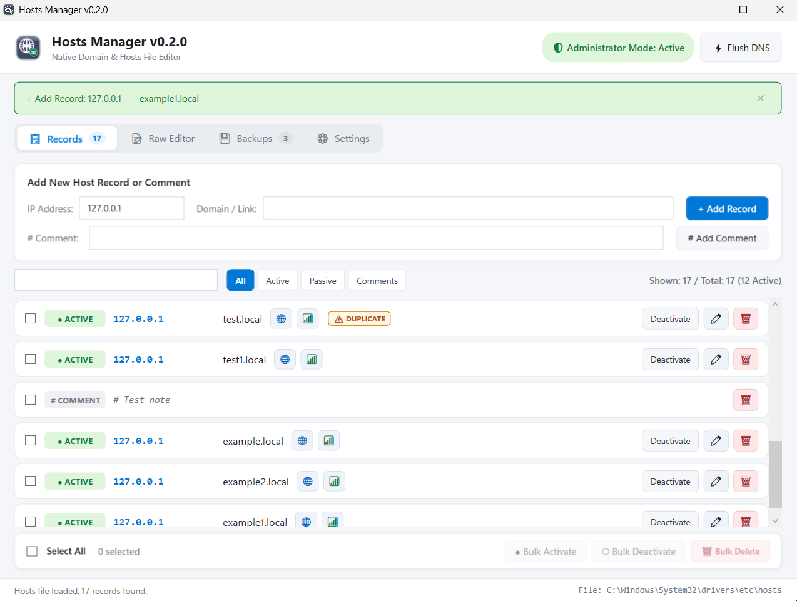
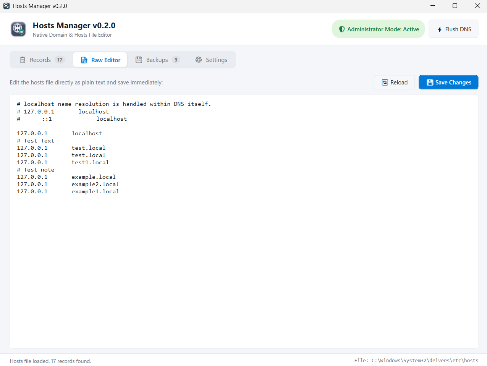
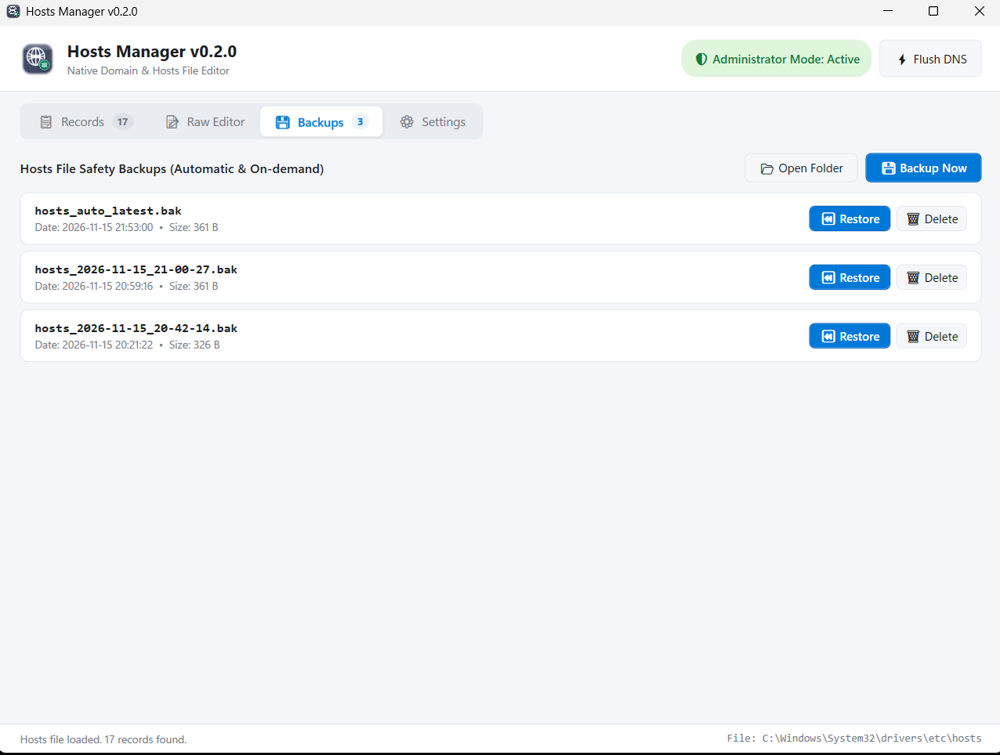
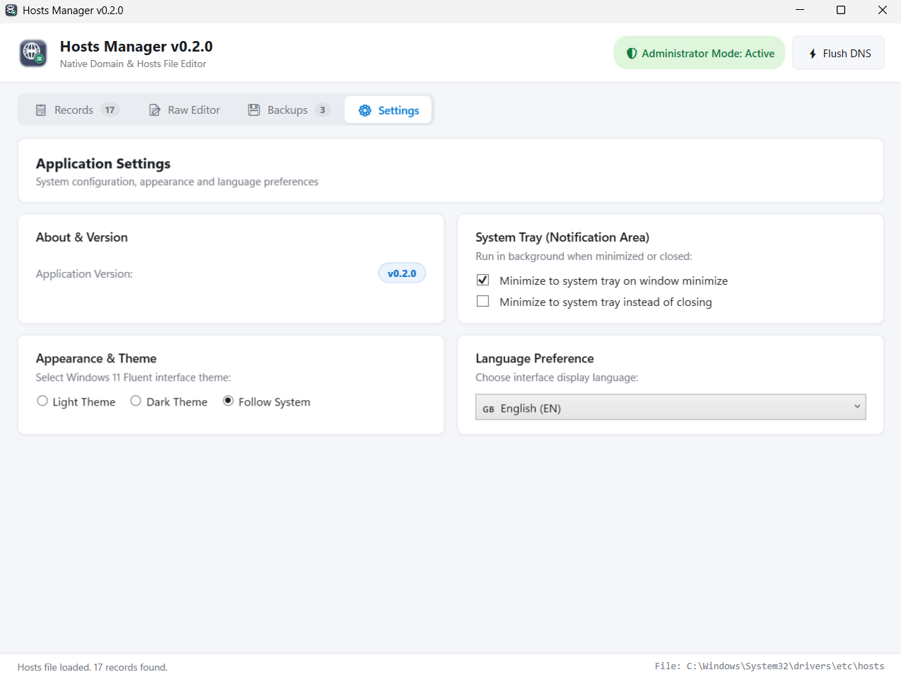

<div align="center">

# 🌐 HostsManager

**C# ve WPF Fluent Design ile geliştirilmiş modern, hafif ve yerel Windows Hosts dosyası yöneticisi.**

[](https://microsoft.com/windows)
[](https://dotnet.microsoft.com/)
[](#-mimari--sıfır-bağımlılık)
[](#-dinamik-çoklu-dil-desteği)
[](LICENSE)

<br />

**[English](README.md)** • **[Türkçe](README-tr.md)**

<br />



</div>

---

## 📖 Genel Bakış

**HostsManager**, yazılımcılar, sistem yöneticileri ve ileri düzey kullanıcılar için Windows `hosts` dosyasını (`C:\Windows\System32\drivers\etc\hosts`) zahmetsizce görüntülemek, düzenlemek, aktif/pasif hale getirmek ve güvenle yönetmek amacıyla tasarlanmış modern bir masaüstü aracıdır.

**Windows 11 Fluent Design** tasarım dili ve saf C# / WPF teknolojisi kullanılarak geliştirilmiş olup, hiçbir harici kütüphane veya çalışma zamanı (runtime) bağımlılığı gerektirmez.

---

## 📸 Ekran Görüntüleri

| 📋 Kayıtlar, Hızlı Düzenleme & Tanılama | 📝 Düz Metin (Raw) Editörü |
| :---: | :---: |
|  |  |
| *Kart tasarımı, canlı ping süresi, çakışma uyarıları, arama ve toplu işlemler* | *Doğrudan hosts dosyası düzenleme, kaydetme ve sıfırlama* |

| 💾 Güvenlik Yedekleri & Geri Yükleme | ⚙️ Ayarlar, Temalar & 12 Dil Desteği |
| :---: | :---: |
|  |  |
| *Otomatik alınan anlık görüntüler, yedek geçmişi ve tek tıkla geri yükleme* | *Açık / Koyu / Sistem teması, 12 dinamik dil ve sistem tepsisi seçenekleri* |

---

## ✨ Temel Özellikler

- **✏️ Satır İçi Hızlı Düzenleme (In-Place Edit):**
  IP adreslerini veya domain adlarını kart üzerinden tek tıkla (`✏️`) düzenleyin. Kaydı silip baştan oluşturma zahmeti ortadan kalkar.

- **🌐 Ağ ve Tanılama Araçları:**
  - **Tarayıcıda Aç:** Domain yanındaki (`🌐`) butonuyla varsayılan tarayıcınızda doğrudan `http://<domain>` adresini açın.
  - **Canlı Asenkron Ping:** Arayüzü dondurmadan arka planda çalışan (`📶`) canlı ping testi ile anlık yanıt süresini (örn: `12ms` / `Zaman Aşımı`) renk kodlarıyla görün.

- **⚠️ Çakışma ve Mükerrer Kontrolü (Conflict Detection):**
  - Aynı domain birden fazla farklı IP'ye yönlendirildiğinde belirgin **`⚠️ ÇAKIŞMA`** rozeti ile uyarır.
  - Mükerrer kayıtları tespit ederek hosts dosyanızın düzenli kalmasını sağlar.

- **📦 Toplu İşlemler ve Çoklu Seçim:**
  - Onay kutuları (Checkbox) ile birden fazla kaydı seçin.
  - Tek tıkla toplu aktif etme, toplu pasife alma veya toplu silme yapın.

- **🌙 Fluent UI ve Koyu / Açık / Sistem Teması:**
  - Windows 11 Fluent Design paleti, modern segment menüler ve rozet sayaçları.
  - **Açık**, **Koyu (Dark Mode)** ve **Sistem Temasını İzle** seçenekleri.

- **🔔 Sistem Tepsisi Entegrasyonu (System Tray):**
  - Simge durumuna küçültüldüğünde bildirim alanında (Taskbar Tray) sessizce çalışır.
  - Sağ tık menüsü: *Yöneticiyi Aç*, *DNS Temizle (Flush DNS)*, *Hosts Klasörünü Aç* ve *Çıkış*.

- **🌍 Dinamik Çoklu Dil Desteği (12 Dil):**
  - Hazır 12 dil paketi: Türkçe, İngilizce, Almanca, Fransızca, İspanyolca, İtalyanca, Portekizce, Rusça, Çince, Japonca, Korece ve Arapça.
  - `languages/` dizinine eklenen yeni `.json` dil dosyalarını yeniden derlemeye gerek kalmadan otomatik algılar.

- **🛡️ Otomatik ve Manuel Yedekleme:**
  - Hosts dosyasındaki her değişiklik öncesinde otomatik güvenlik yedeklemesi alır.
  - Ayrı bir sekmede yedek geçmişini inceleyebilir ve tek tıkla eski yedeğe dönebilirsiniz.

- **⚡ Tek Tıkla DNS Temizleme (Flush DNS):**
  - Yapılan değişikliklerin hemen geçerli olması için Windows DNS çözümleyici önbelleğini tek tıkla temizler.

---

## 🏛️ Mimari & Sıfır Bağımlılık

- **Saf Yerel Uygulama (.exe):** Sadece Windows'un yerleşik `.NET Framework / WPF` bileşenlerini kullanır. Python, Node.js, Electron gibi harici çalışma zamanlarına ihtiyaç duymaz.
- **Dahili UAC Yönetici Kalkanı:** Gömülü `app.manifest` (`requireAdministrator`) sayesinde hosts dosyası yazma izinleri için otomatik olarak yönetici haklarıyla başlar.
- **Hafif ve Taşınabilir:** Tek bir bağımsız yürütülebilir dosya olarak çalışır.

---

## 🌐 Dinamik Çoklu Dil Desteği

HostsManager, yeniden derleme gerektirmeyen dinamik bir çoklu dil mimarisine sahiptir. Tüm arayüz metinleri C# kodundan ayrıştırılmış olup [`languages/`](languages/) klasörü altındaki hafif JSON dosyalarında tutulur.

### Mevcut Diller (12 Dil Destekli)

Uygulama açılırken `languages/` dizinindeki tüm dil dosyalarını otomatik olarak tarar ve alfabetik (harf) sırasına göre listeler:

| Bayrak | Dil | Yerel Adı | Kod | Dosya |
| :---: | :--- | :--- | :---: | :--- |
| 🇸🇦 | **Arapça** | العربية | `ar` | [`languages/ar.json`](languages/ar.json) |
| 🇩🇪 | **Almanca** | Deutsch | `de` | [`languages/de.json`](languages/de.json) |
| 🇬🇧 | **İngilizce** | English | `en` | [`languages/en.json`](languages/en.json) |
| 🇪🇸 | **İspanyolca** | Español | `es` | [`languages/es.json`](languages/es.json) |
| 🇫🇷 | **Fransızca** | Français | `fr` | [`languages/fr.json`](languages/fr.json) |
| 🇮🇹 | **İtalyanca** | Italiano | `it` | [`languages/it.json`](languages/it.json) |
| 🇯🇵 | **Japonca** | 日本語 | `ja` | [`languages/ja.json`](languages/ja.json) |
| 🇰🇷 | **Korece** | 한국어 | `ko` | [`languages/ko.json`](languages/ko.json) |
| 🇵🇹 | **Portekizce** | Português | `pt` | [`languages/pt.json`](languages/pt.json) |
| 🇷🇺 | **Rusça** | Русский | `ru` | [`languages/ru.json`](languages/ru.json) |
| 🇹🇷 | **Türkçe** | Türkçe | `tr` | [`languages/tr.json`](languages/tr.json) |
| 🇨🇳 | **Çince (Basitleştirilmiş)** | 简体中文 | `zh` | [`languages/zh.json`](languages/zh.json) |

### Yeni Dil Nasıl Eklenir?

Kod değiştirmeden veya yeniden derleme yapmadan saniyeler içinde yeni bir dil ekleyebilirsiniz:
1. `languages/` klasöründeki herhangi bir dosyayı (örneğin `tr.json`) kopyalayın ve ISO koduna göre adlandırın (örneğin `az.json` veya `nl.json`).
2. Dosya içerisindeki `"LanguageDisplayName"` alanını (örneğin `"🇦🇿  Azərbaycan (AZ)"`) ve metinleri tercüme edin.
3. Uygulamayı açtığınızda yeni dil otomatik olarak algılanacak ve Ayarlar sekmesindeki listede alfabetik sırasına göre görüntülenecektir!

---

## 📁 Proje Dizin Yapısı

```plaintext
HostsManager/
├── languages/                     # Dinamik JSON dil paketleri (12 Dil)
│   ├── tr.json                    # Türkçe
│   ├── en.json                    # İngilizce
│   ├── de.json                    # Almanca
│   └── ...                        # Diğer diller
├── screenshot/                    # Arayüz Ekran Görüntüleri
│   ├── Screenshot_1_Records.png
│   ├── Screenshot_2_Raw_Editor.png
│   ├── Screenshot_3_Backups.png
│   └── Screenshot_4_Settings.png
├── app.manifest                   # UAC Yönetici izin manifestosu
├── app.png                        # Uygulama logosu & ikon kaynağı
├── HostsManager.cs                # Tek dosya C# WPF uygulama kaynak kodu
├── README.md                      # İngilizce dokümantasyon (Ana)
└── README-tr.md                   # Türkçe dokümantasyon
```

---

## 🛠️ Kaynak Koddan Derleme

Visual Studio kurmanıza gerek yoktur. `.NET Framework 4.0+` yüklü olan tüm modern Windows işletim sistemlerinde bulunan yerleşik C# derleyicisi (`csc.exe`) ile derlenebilir.

### Komut İstemi / PowerShell ile Derleme:

```cmd
C:\Windows\Microsoft.NET\Framework64\v4.0.30319\csc.exe /nologo /t:winexe /optimize+ /platform:anycpu ^
  /win32manifest:app.manifest ^
  /r:"C:\Windows\Microsoft.NET\Framework64\v4.0.30319\WPF\PresentationFramework.dll" ^
  /r:"C:\Windows\Microsoft.NET\Framework64\v4.0.30319\WPF\PresentationCore.dll" ^
  /r:"C:\Windows\Microsoft.NET\Framework64\v4.0.30319\WPF\WindowsBase.dll" ^
  /r:System.dll ^
  /r:System.Core.dll ^
  /r:System.Drawing.dll ^
  /r:System.Windows.Forms.dll ^
  /r:System.Xaml.dll ^
  /r:System.Web.Extensions.dll ^
  /out:HostsManager.exe ^
  HostsManager.cs
```

---

## 📄 Lisans

Bu proje açık kaynaklıdır ve [MIT Lisansı](LICENSE) kapsamında sunulmaktadır.
