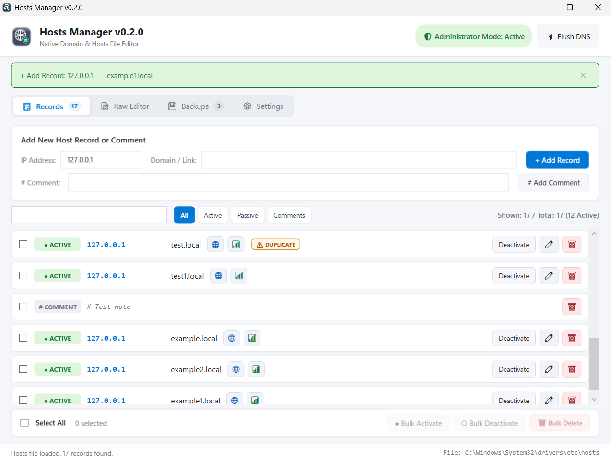
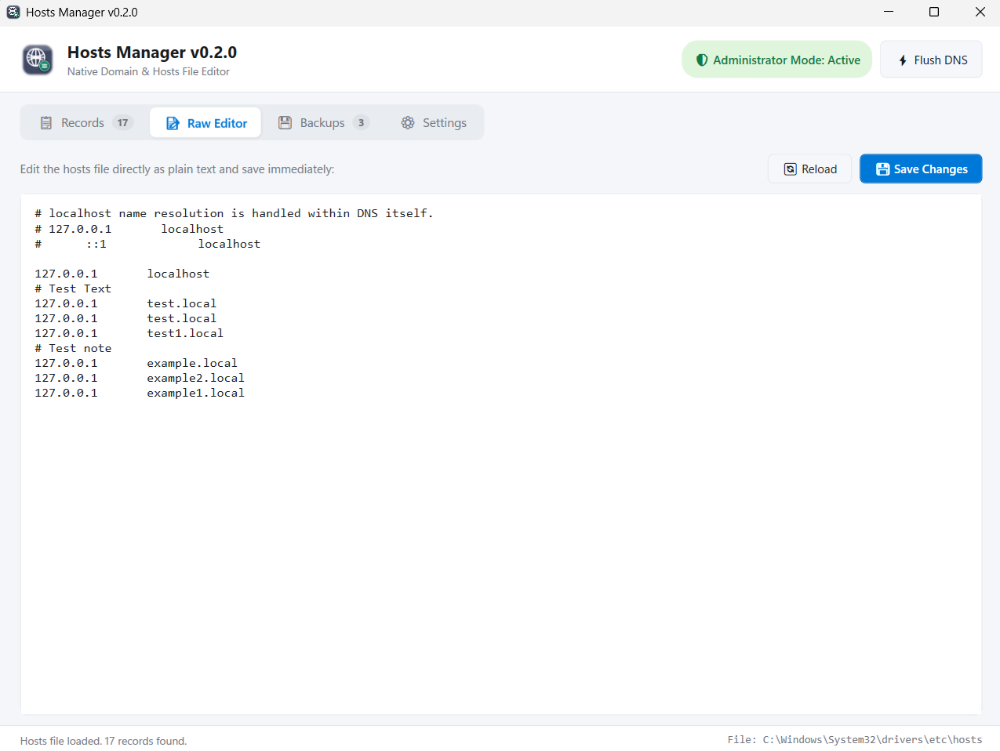
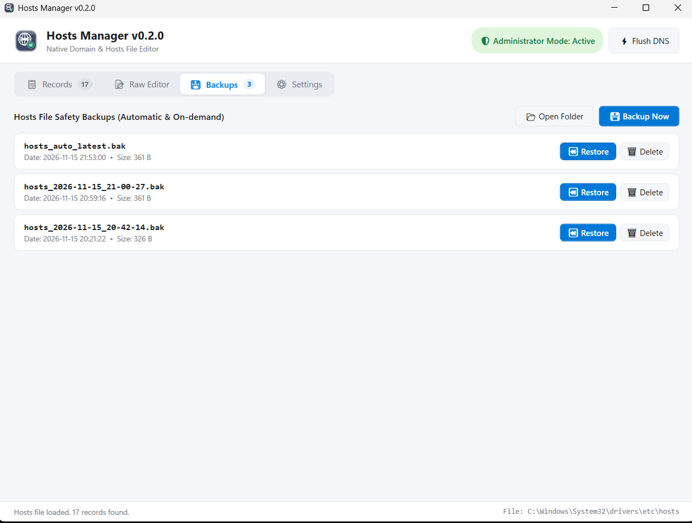
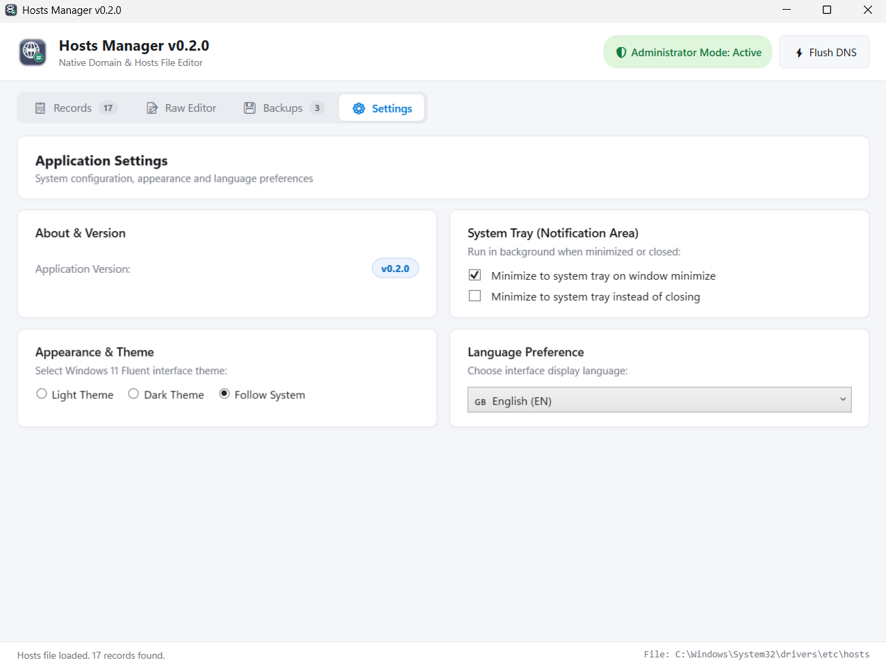

<div align="center">

# 🌐 HostsManager

**A modern, lightweight Windows Hosts file manager built with C# and WPF Fluent Design.**

[](https://microsoft.com/windows)
[](https://dotnet.microsoft.com/)
[](#-architecture--zero-dependency)
[](#-dynamic-multi-language-architecture)
[](LICENSE)

<br />

**[English](README.md)** • **[Türkçe](README-tr.md)**

<br />



</div>

---

## 📖 Overview

**HostsManager** is an intuitive, fast, and native Windows desktop tool designed for developers, system administrators, and power users to effortlessly view, edit, toggle, and organize the Windows `hosts` file (`C:\Windows\System32\drivers\etc\hosts`).

Built with native C# / WPF following the **Windows 11 Fluent Design** language, it delivers a smooth desktop experience with zero external runtime dependencies.

---

## 📸 Screenshots

| 📋 Records, Quick Edit & Diagnostics | 📝 Raw Hosts Text Editor |
| :---: | :---: |
|  |  |
| *Card-based records, live ping latency, conflict badges, search & bulk actions* | *Direct hosts file editor with quick save and reset* |

| 💾 Safety Backups & Restore | ⚙️ Settings, Themes & 12 Languages |
| :---: | :---: |
|  |  |
| *Automated snapshots, backup timeline, and one-click restore* | *Light / Dark / System themes, dynamic multi-language switcher & tray options* |

---

## ✨ Key Features

- **✏️ In-Place Quick Edit:**
  Edit IP addresses and domain names directly inside cards with instant validation—no need to delete and recreate entries.

- **🌐 Network & Diagnostic Tools:**
  - **Open in Browser:** One-click shortcut (`🌐`) to launch the domain in your default browser.
  - **Live Asynchronous Ping:** Test domain latency in real-time (`📶`) with color-coded response times (e.g., `12ms` / `Timeout`) without blocking the UI.

- **⚠️ Conflict & Duplicate Detection:**
  - Visual badges (`⚠️ CONFLICT`) when multiple different IPs are mapped to the same domain.
  - Duplicate record warnings to keep your hosts file clean.

- **📦 Bulk Operations & Multi-Select:**
  - Batch select entries using checkboxes.
  - Perform bulk enable, bulk disable, or bulk delete in a single click.

- **🌙 Fluent UI with Dark / Light / System Theme:**
  - Full Windows 11 Fluent Design palette with segmented pill menus and modern typography.
  - Supports **Light**, **Dark**, and **Follow System Theme** with persistent settings.

- **🔔 System Tray Integration:**
  - Minimize to the taskbar notification area.
  - Tray context menu with quick actions: *Open Manager*, *Flush DNS*, *Open Hosts Directory*, and *Exit*.

- **🌍 Dynamic Multi-Language Architecture:**
  - Includes **12 ready-to-use languages**: English, Turkish, German, French, Spanish, Italian, Portuguese, Russian, Chinese, Japanese, Korean, and Arabic.
  - Dynamically detects any new `.json` language files placed in the `languages/` directory without recompilation.

- **🛡️ Automatic & Manual Backups:**
  - Automated safety snapshots before every hosts file modification.
  - Visual backup history tab with one-click restore.

- **⚡ Instant DNS Cache Flush:**
  - Clear the Windows resolver cache (`Flush DNS`) with a single click.

---

## 🏛️ Architecture & Zero-Dependency

- **Pure Native Binary:** Uses only Windows built-in `.NET Framework / WPF` assemblies. No Python, Node.js, Electron, or heavy runtimes required.
- **Embedded UAC Elevation:** Includes an embedded `app.manifest` (`requireAdministrator`), ensuring seamless Administrator privilege elevation required to edit the system hosts file.
- **Portable & Fast:** Compiles into a lightweight standalone executable.

---

## 📁 Repository Structure

```plaintext
HostsManager/
├── languages/                     # Dynamic JSON language packs (12 languages)
│   ├── en.json                    # English
│   ├── tr.json                    # Turkish
│   ├── de.json                    # German
│   └── ...                        # Other languages
├── screenshot/                    # UI Screenshots
│   ├── Screenshot_1_Records.png
│   ├── Screenshot_2_Raw_Editor.png
│   ├── Screenshot_3_Backups.png
│   └── Screenshot_4_Settings.png
├── app.manifest                   # UAC Administrator execution manifest
├── app.png                        # Application logo & icon source
├── HostsManager.cs                # Single-source C# WPF application
├── README.md                      # English documentation (Main)
└── README-tr.md                   # Turkish documentation
```

---

## 🛠️ Building from Source

You do not need Visual Studio installed. Any modern Windows machine with `.NET Framework 4.0+` includes the native C# compiler (`csc.exe`).

### Compile using Command Prompt / PowerShell:

```cmd
C:\Windows\Microsoft.NET\Framework64\v4.0.30319\csc.exe /nologo /t:winexe /optimize+ /platform:anycpu ^
  /win32manifest:app.manifest ^
  /r:"C:\Windows\Microsoft.NET\Framework64\v4.0.30319\WPF\PresentationFramework.dll" ^
  /r:"C:\Windows\Microsoft.NET\Framework64\v4.0.30319\WPF\PresentationCore.dll" ^
  /r:"C:\Windows\Microsoft.NET\Framework64\v4.0.30319\WPF\WindowsBase.dll" ^
  /r:System.dll ^
  /r:System.Core.dll ^
  /r:System.Drawing.dll ^
  /r:System.Windows.Forms.dll ^
  /r:System.Xaml.dll ^
  /r:System.Web.Extensions.dll ^
  /out:HostsManager.exe ^
  HostsManager.cs
```

---

## 📄 License

This project is open-source and available under the [MIT License](LICENSE).
